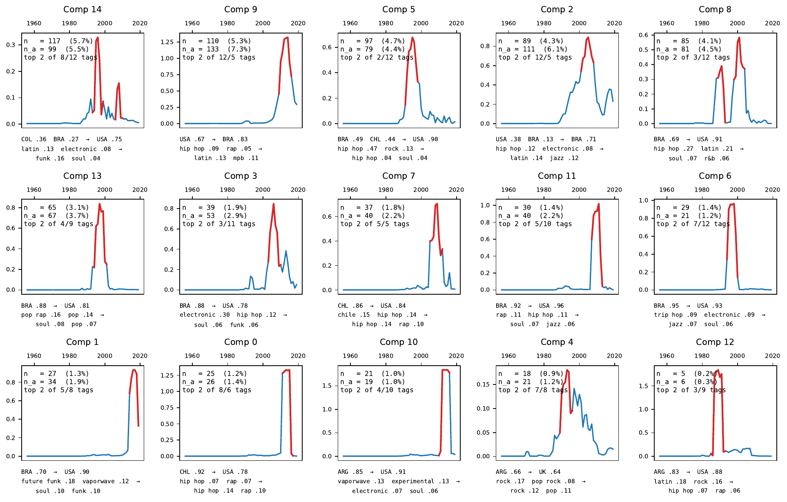

# El Baile de los Préstamos: Decomposing Intellectual Borrowings To and From Latin America

Repository regarding the paper published in the 2nd Latin American Music Information Retrieval (LAMIR) workshop.

In order to reproduce our results we organize this repo in two parts: (A) steps [1,2,3] guide you to reproduce the dataset collection we did and run the string matching threshold decision analysis; (B) if you are only interested in the final data and analysis, follow the step [4], the `/data` folder already contains the pre-processed data ready for analysis.

Additionally, in the end of this page and in the `/results` folder we provide plot results that were not included in the paper final version. 

## 0. Clone this repo

## 1. Download Whosampled-data

We build on the data collected and released by [[1] Guilherme Soares S. dos Santos and Flavio Figueiredo](https://arxiv.org/abs/2411.01242). Download the dataset and extract it into `/data`.

```
https://github.com/uai-ufmg/whosampleddata
```


WhoSampled describes the same relationship between tracks in different ways ("X sampled Y" or "Y was sampled in X", and likewise for remixes and covers). Run the following script, which standardizes everything into three types (sampled, is a remix of, is a cover of), always in the same direction, and splits the dataset into one subset per type, so that the study starts from consistent data. Although the `covers` and `remixes` datasets are available, we will only use the `whosampled-data-samples.json` set.

```sh
python scripts/whosampled-split.py data/whosampled.json -o data
```

## 2. Setup the MusicBrainz local dataset

MusicBrainz's database is a PostgreSQL intance you can set following the link below.


```
https://musicbrainz.org/doc/MusicBrainz_Database/Download
```

After setting it you should verify if the `config.yaml` credentials matches to the version you are running.

## 3. Getting the final dataset merged

### 3.1 Retrieving data from MusicBrainz

In order to rerun our full dataset merging retrieval you should run the command below. The `--input` flag is the subset of samples from the whosampled-data we treated in step 1; the `--similarity-threshold` is the pg_trgm threshold postgres algorithm for string matching that uses trigams; and the `--threshold` is the value for the python's difflib algorithm for the second filter of string matching. The code works on batches of samples instances, so point a folder `--output-dir` to save them.

```sh
scripts/mine_musicbrainz.py --output-dir ./results/samples --similarity-threshold 0.5 --threshold 0.85 --input data/whosampled-data-samples.json --batch-size 1000
```

After all batches being recovered, use the `notebooks/merge_batches.ipynb` to get the full dataset `whomsampled-brainz.jsonl`.

### 3.2 Cleaning the dataset

Since, by default, we cap the Recordings matching per song retrieved at N=50, there is a lot of duplicate informations in the generated file. Also, we need to filter the tags we are going to use, since there are tags in the (song > release > release group > artist) levels, we want to keep the tags from the lowest level, that we believe that are more accurate to the audio itself. Another detail is that the script that retrieves from the databse doesnt filter out the matches with different year match compared to the info that comes from whosampled-data, in this phase we want to cap off the instances that differ more than ±1 years from the year annotated in the whomsapled-data.  

```
execute blocks of notebooks/cleaning_whosampled_brainz.ipynb
```

### 3.3 Finding and renaming duplicated tags

Finally, to enhance the quality of the tags in the dataset, we use the difflib to measure the similarity between the tags strings and create the `/data/tags_mapping.csv` file, containing in each line pairs of name tags that seems to refer to the same concept - we treated before some special cases in the code. Then we validate manually every line which tags should be renamed or not. After that, we reload the file and substitute these tags in the dataset.

```
execute blocks of notebook/tag_normalization.ipynb
```

## 4.  PARAFAC on Latin America community

The final dataset used in this step can be found in `data/whosampled-brainz-final.jsonl`.

Consult the `parafac_LA.ipynb` to reproduce our analysis steps.

## 5. Additional Plots can be found in `/results`

